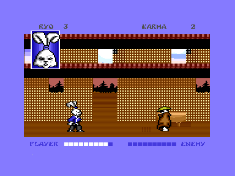

# Usagi Yojimbo per plus/64 — 23 November 2026

**Startup correction (23 November):** [Download the small launcher patch](./plus64-usagi-correzione-avvio.zip) (3,431 bytes). Extract its four launcher files into the existing game folder, replacing the old ones. It disables true-drive emulation so the supplied disk loader can use fast ROM traps; normal gameplay speed remains enabled. Both C16 and Plus/4 launchers reached the menu and game in about 8–10 seconds in the recorded checks.

Further corrections for scrolling artwork, bridge foregrounds, Ninja blood and rendering performance are in progress. The full ZIP below does not yet include those corrections or this launcher patch.

[Download the complete ZIP](./plus64-usagi-yojimbo-2026-11-23.zip) — 50,458,086 bytes (48.1 MiB).

Extract the complete archive, open `plus64-usagi`, then run `AVVIA_USAGI.cmd` for C16 or `AVVIA_USAGI_PLUS4.cmd` for Plus/4. F5 in the starting menu selects English or Italian. Both launchers use the same disk image. The Linux launchers use separately installed Wine64 and the same supplied Windows executable.

The guest memory budget remains **64 KiB + 16 KiB = 81,920 bytes**. Only the active scene's colour program is loaded into its reserved RAM slot; scene changes can pause for disk loading. ZIP, executable and source sizes are separate from guest RAM usage.

The ZIP includes the game, runtime, full Italian and English technical developer manuals, editable artwork, portable game reconstruction tools, corresponding emulator sources and licenses. The native Linux headless executable is a developer/QA tool.

## Technical developer manuals

- [Italian — complete 52-page manual](./Manuale_Sviluppatore_PLUS64_RAM80_IT.pdf)
- [English — complete 52-page manual](./PLUS64_RAM80_Developer_Manual_EN.pdf)

HTML, Markdown, all chapters, code examples and quick references are also included in the full ZIP.

## Validation

The reviewed release passed 34 real emulator cold starts (17 scenes on each machine profile), native background comparisons, actual PC keyboard controls through Wine on both profiles and the Linux/Wine launcher check. Eight complex-view GUI fixtures presented every tested raster frame at approximately 50 Hz, with no skipped frames. The included reports distinguish controlled scene/render fixtures from ordinary input and gameplay, and record the exact coverage. Native Windows, physical hardware and a completed campaign are not claimed.

[SHA256 checksums](./SHA256SUMS.txt) · [Forum post draft](./POST_FORUM_EN.md)

