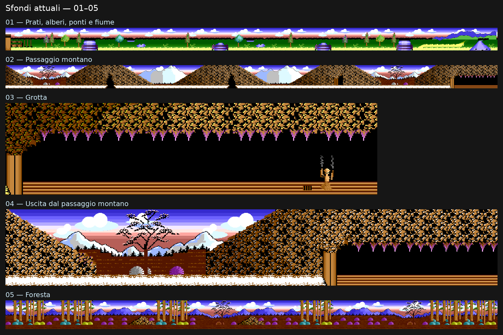
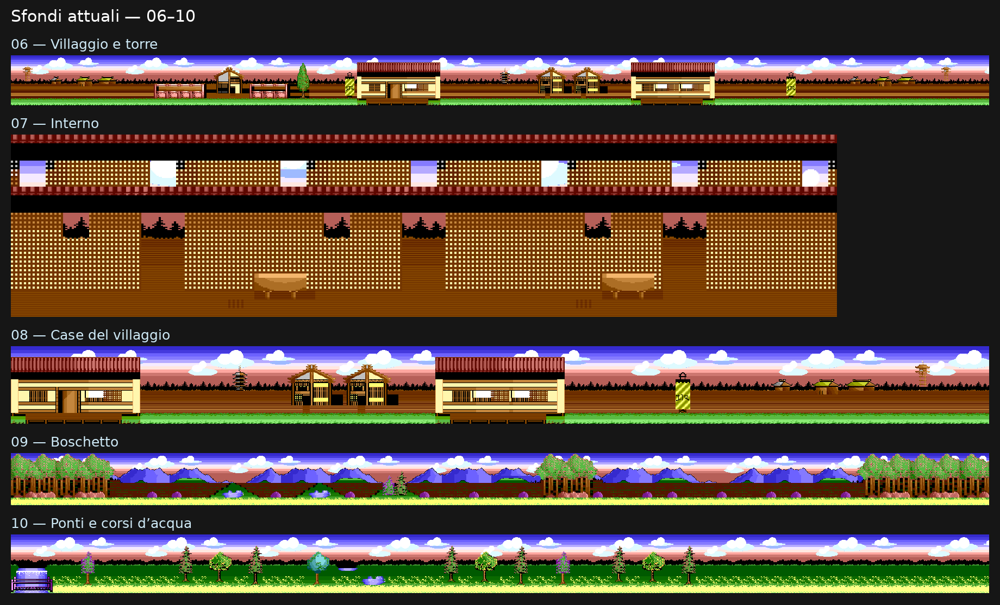
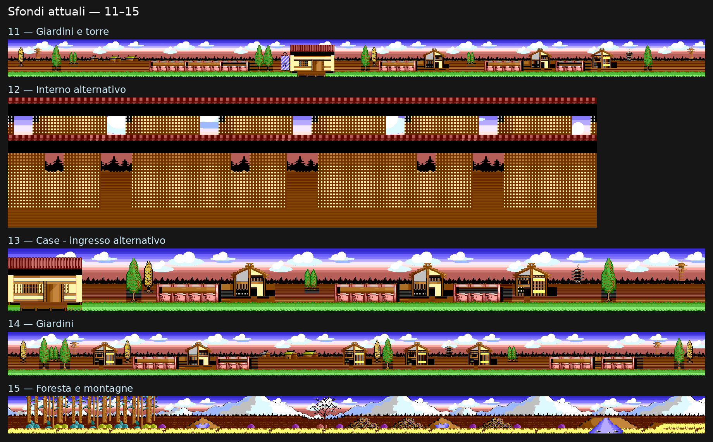
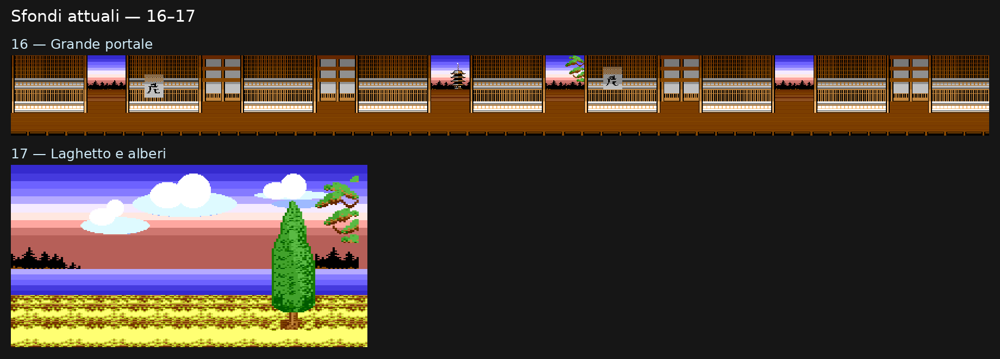

# Usagi Yojimbo — panoramica degli sfondi attuali

Versione del gioco del 24 novembre 2026. Sono 17 sfondi e varianti, non 17 livelli consecutivi.
Indica il numero e il punto da cambiare; nelle panoramiche complete puoi usare il settore, per esempio **01-C, il ponte**.

[Scarica tutte le panoramiche e le quattro tavole in ZIP](usagi-panoramiche-sfondi.zip)

| Sfondo | Panoramica completa |
| --- | --- |
| 01 — Prati, alberi, ponti e fiume | [PNG 2x](panoramas/sfondo-01-panoramica.png) |
| 02 — Passaggio montano | [PNG 2x](panoramas/sfondo-02-panoramica.png) |
| 03 — Grotta | [PNG 2x](panoramas/sfondo-03-panoramica.png) |
| 04 — Uscita dal passaggio montano | [PNG 2x](panoramas/sfondo-04-panoramica.png) |
| 05 — Foresta | [PNG 2x](panoramas/sfondo-05-panoramica.png) |
| 06 — Villaggio e torre | [PNG 2x](panoramas/sfondo-06-panoramica.png) |
| 07 — Interno | [PNG 2x](panoramas/sfondo-07-panoramica.png) |
| 08 — Case del villaggio | [PNG 2x](panoramas/sfondo-08-panoramica.png) |
| 09 — Boschetto | [PNG 2x](panoramas/sfondo-09-panoramica.png) |
| 10 — Ponti e corsi d’acqua | [PNG 2x](panoramas/sfondo-10-panoramica.png) |
| 11 — Giardini e torre | [PNG 2x](panoramas/sfondo-11-panoramica.png) |
| 12 — Interno alternativo | [PNG 2x](panoramas/sfondo-12-panoramica.png) |
| 13 — Case - ingresso alternativo | [PNG 2x](panoramas/sfondo-13-panoramica.png) |
| 14 — Giardini | [PNG 2x](panoramas/sfondo-14-panoramica.png) |
| 15 — Foresta e montagne | [PNG 2x](panoramas/sfondo-15-panoramica.png) |
| 16 — Grande portale | [PNG 2x](panoramas/sfondo-16-panoramica.png) |
| 17 — Laghetto e alberi | [PNG 2x](panoramas/sfondo-17-panoramica.png) |

Le immagini ricostruiscono i dati grafici effettivi della versione pubblicata con il renderer C21/P64B. Comprendono gli ultimi alberi e il prato aggiornato; non contengono personaggi dinamici. Le nuvole legate alla vista sono campionate in finestre successive da 320 pixel. Sono mappe composte, non singoli screenshot. Il gioco non viene modificato.

**English:** Current game scenery, rendered from the released MAIN and P64B packets with the actual C implementation. The 17 IDs denote layouts and variants, not 17 sequential levels. Full panoramas preserve exact pixels at 2x scale and label 320px sectors. Overview sheets may reduce long maps. Dynamic sprites are omitted; screen-space clouds are sampled in successive views. No game files are modified.
