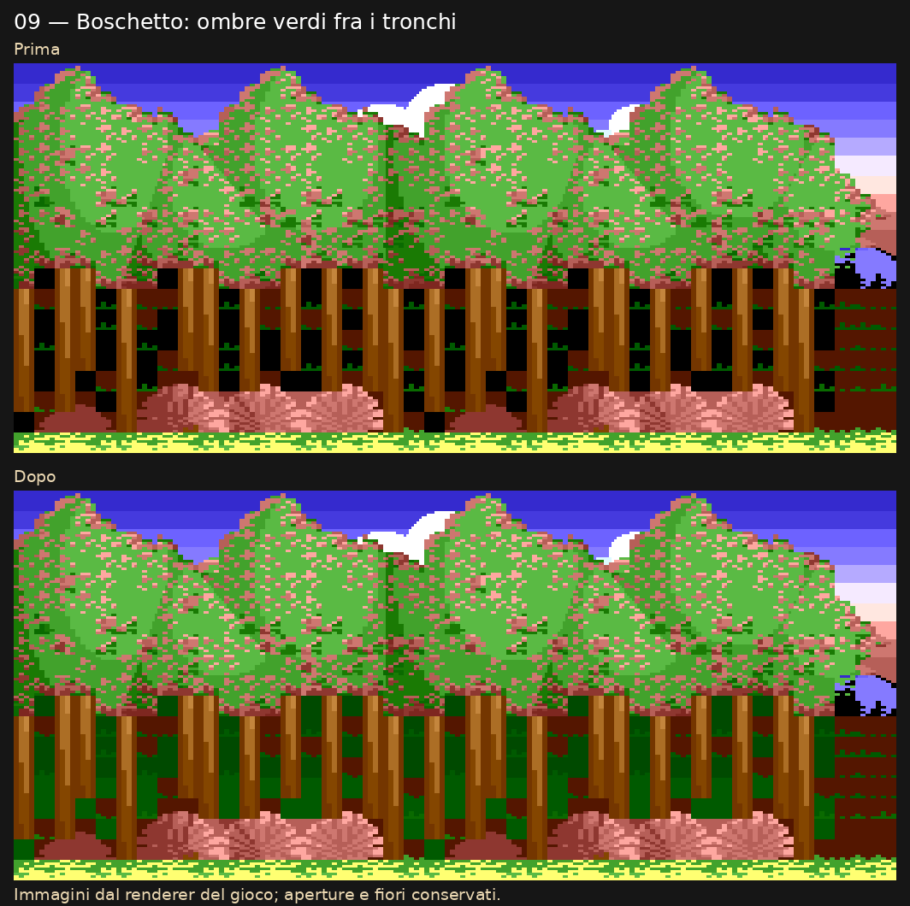
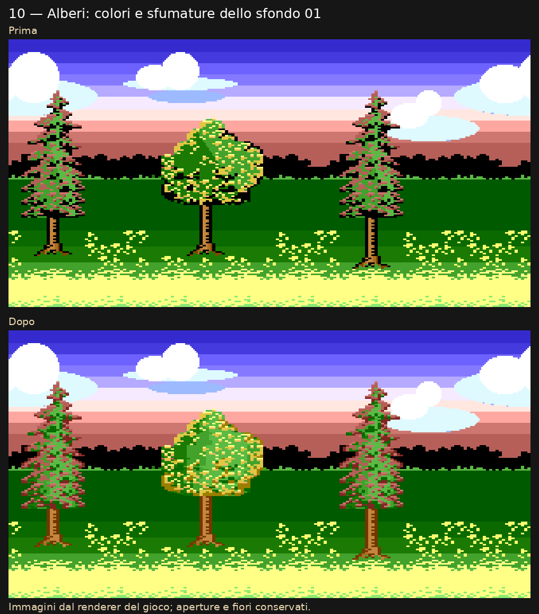

# Usagi Yojimbo — revisione sfondi 09 e 10

24 novembre 2026.

- **09, boschetto:** il nero opaco del sottobosco fra i tronchi diventa verde scuro, con due toni. Le aperture reali, i fiori e i tronchi sono conservati.
- **10, ponti e corsi d’acqua:** tutti i 12 alberi riprendono gli stessi materiali, colori e sfumature approvati per lo sfondo 01.

[Scarica l’aggiornamento del gioco e i sorgenti completi](plus64-usagi-sfondi-09-10.zip). Sostituisci USAGI.D64 nella copia attuale e avvia una nuova partita. Il runtime plus/64 resta quello già distribuito.

[Panoramica completa 09](images/09-panoramica.png) · [Panoramica completa 10](images/10-panoramica.png)

Le immagini derivano dai dati effettivi del gioco, elaborati dal renderer C21/P64B. Verifica focalizzata su colori, maschere, pacchetti, disco e ricostruzione dei sorgenti. La logica di gioco e gli altri 15 sfondi restano identici alla versione precedente. Rimane il limite di **64 + 16 KiB = 81.920 byte**.

## English

Scenery 09: deep green shades replace opaque black undergrowth between trunks; actual openings, flowers and wood are preserved. Scenery 10: all 12 trees use the exact materials and shading approved for scenery 01.

The ZIP contains the updated USAGI.D64 and complete game sources. Replace the disk in the current installation and start a new game; the existing plus/64 runtime is unchanged. The previews use the actual C21/P64B renderer. Checks focus on pixels, masks, packets, disk contents and source rebuilds. Game logic and the other 15 scenery packets remain unchanged. The guest memory budget remains 64 + 16 KiB (81,920 bytes).
