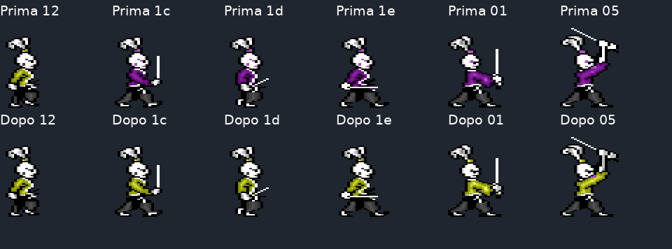
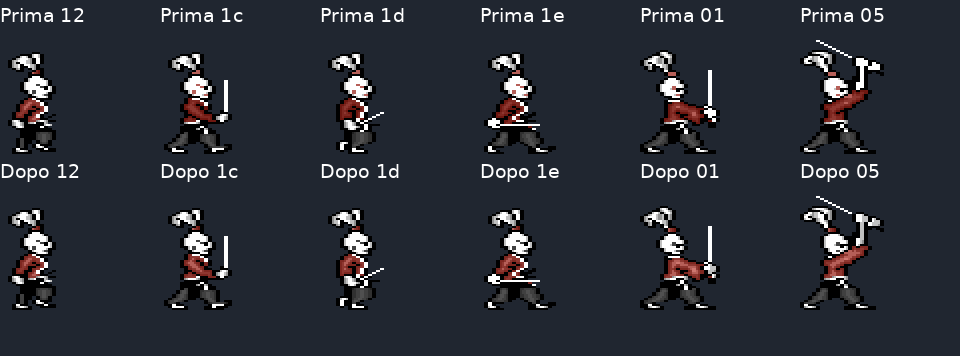
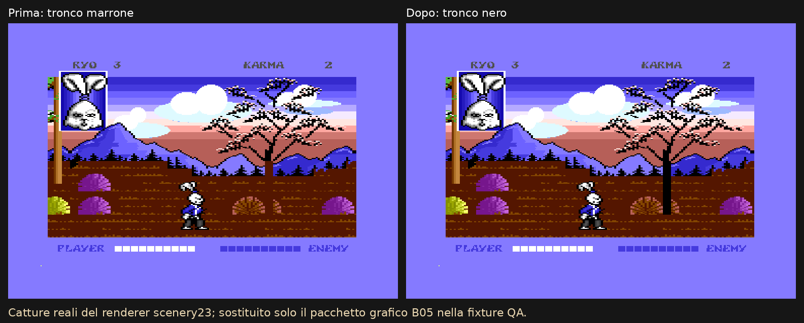

# Usagi Yojimbo plus/64 — pacchetto completo R2

27 novembre 2026.

[**Scarica il pacchetto completo aggiornato per Windows (ZIP, 53,4 MB)**](plus64-usagi-completo-r2-2026-11-27.zip)

Questa versione corregge i tre problemi segnalati:

- **Taverna:** corretto il caricamento all'ingresso che lasciava lo schermo di un solo colore.
- **Samurai coniglio:** rosso e giallo rimangono coerenti quando estraggono la spada.
- **Peschi bianchi nel bosco:** tronchi e rami neri, con fiori e chiome conservati.

Estrai tutto in una nuova cartella, apri **plus64-usagi** e avvia **AVVIA_USAGI.cmd**. **AVVIA_USAGI_PLUS4.cmd** seleziona l'ospite Plus/4. Include emulatore, ROM, librerie, gioco aggiornato, manuali tecnici IT/EN per programmare plus/64, sorgenti completi e licenze. Tutte le correzioni precedenti, compresi gli sfondi09/10, sono incluse.

Frecce e Spazio per giocare; F1 seleziona GAME, F7 avvia, F5 cambia italiano/inglese. Il budget rimane **64 + 16 KiB = 81.920 byte**. L'emulatore è invariato; la correzione interessa il codice e i dati del gioco.

Sul disco finale sono stati verificati ingresso, uscita e rientro **6→7→8→7→8** su C16 e Plus/4 in Linux, mantenendo il disco collegato dall'avvio. La prova mirata usa una fixture dichiarata per evitare gli scontri; nessuna patch QA o salvataggio è inclusa nel gioco. Verificati inoltre il decoder C, i pixel grafici e la ricostruzione dai sorgenti estratti. La causa del caricamento è stata verificata separatamente sotto Wine. Queste prove non sono una campagna completa, una prova Windows nativa o una prova su hardware fisico.

## English

[Download the complete Windows R2 package](plus64-usagi-completo-r2-2026-11-27.zip). Extract everything into a fresh folder, open **plus64-usagi**, and run **AVVIA_USAGI.cmd** or **AVVIA_USAGI_PLUS4.cmd**.

Fixes the uniform-screen freeze during tavern entry, rabbit-samurai clothing colour changes when drawing the sword, and brown trunks on the white-blossom peach trees. Includes every earlier update, the emulator, ROMs, libraries, Italian/English technical programming manuals, complete corresponding sources and licences. The emulator is unchanged. Guest memory remains64+16KiB (81,920bytes).

The final disk passed bounded C16/Plus4 Linux entry/exit/re-entry checks through6→7→8→7→8 with one cold disk attachment and explicit NPC/health QA fixtures, plus C artwork checks and a rebuild from extracted sources. The I/O cause was checked independently under Wine. No QA patch or save is shipped. These are not Windows-native, physical-hardware or full-campaign playtests.
